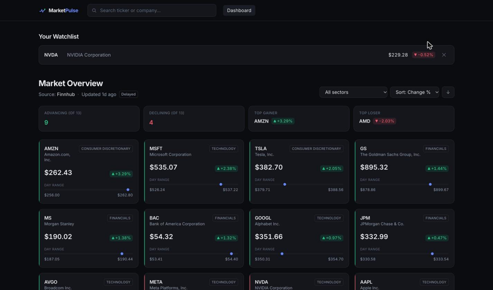
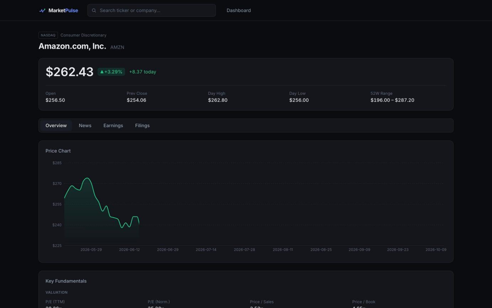
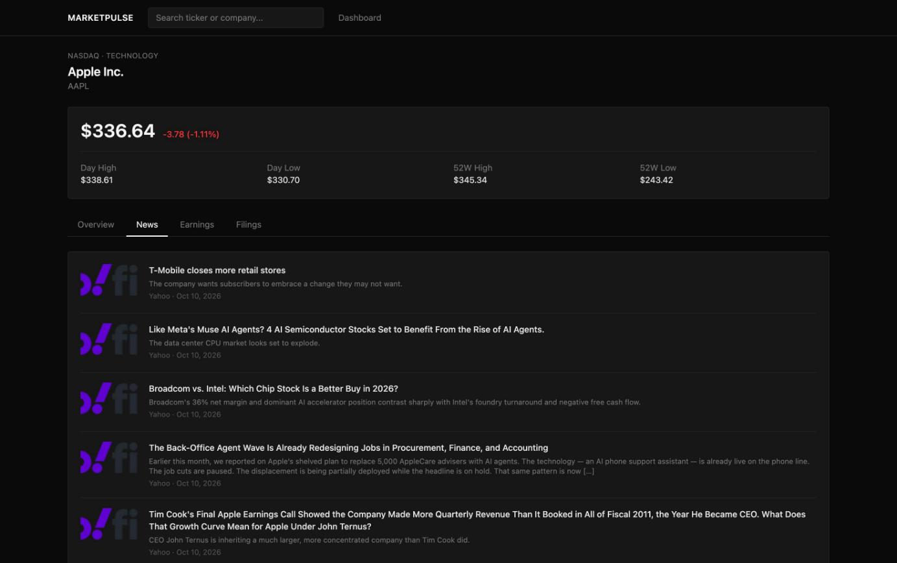
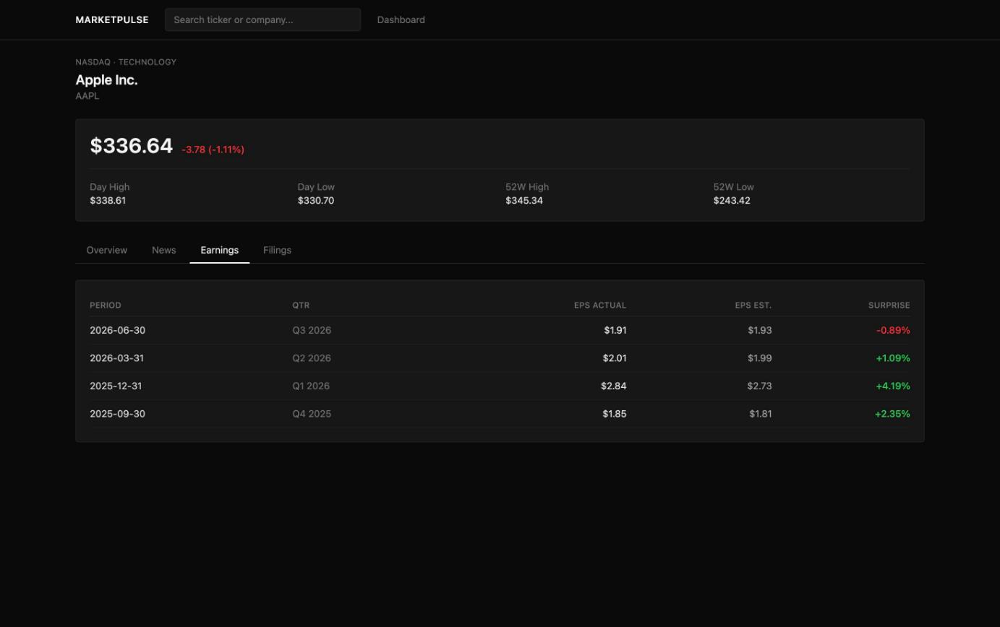
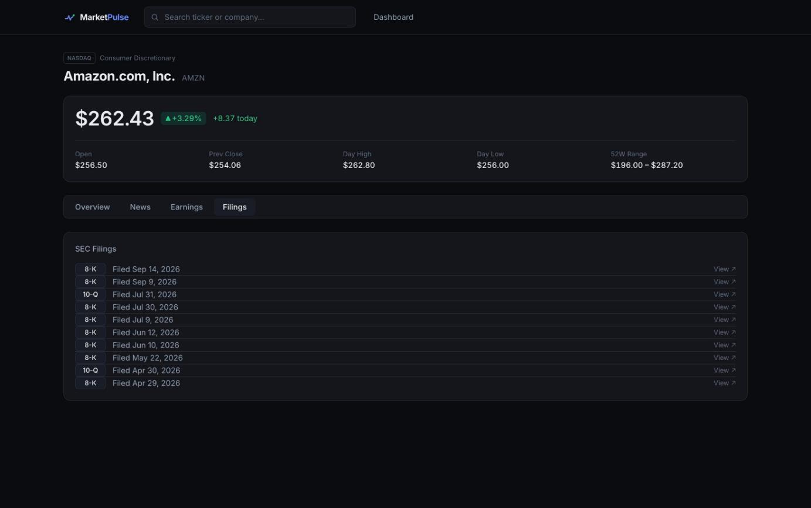

# MarketPulse

A full-stack market research dashboard. Browse tracked companies on a live
market overview, open any company for a quote, an interactive price chart with
selectable time ranges, fundamentals, news, earnings and SEC filings, and keep a
personal watchlist — all assembled from external market-data APIs behind a
cached, resilient backend.


**Stack:** React 19 + TypeScript + Vite · Spring Boot 4 (Java 21) · PostgreSQL ·
Caffeine caching · Docker Compose

---

## Screenshots

### Dashboard — watchlist + market overview
Your watchlist up top; below it, tracked companies sorted by the day's move with
market-breadth stats. The header shows the data **source** and **last-updated**
time, with a *Delayed* / *Stale* badge so the freshness of the data is explicit.



### Company page — Overview
Live quote with day/52-week range, an interactive price chart with 1M/3M/6M/1Y/MAX
ranges, and grouped fundamentals (valuation, profitability, growth).



### Company page — News, Earnings, Filings
Lazily-loaded tabs: a news feed, an EPS actual-vs-estimate table with beat/miss
coloring, and SEC filings linking out to EDGAR. Each panel cites its source.

| News | Earnings | Filings |
| --- | --- | --- |
|  |  |  |

---

## Features

- **Market overview dashboard** — every tracked company with its live quote and
  an intraday day-range indicator, sorted by percent change, with top gainer /
  top loser and advancing / declining stats scoped to the current filter.
  Client-side **sorting** (change %, price, ticker, name) and **sector filter**.
- **Data provenance** — the overview reports its `source` and an `asOf` timestamp
  (latest quote time). Data is labeled **Delayed** normally and **Stale** when
  it's served from the last-good cache after a provider failure. Nothing is
  fabricated — a failed source shows an explicit empty/unavailable state.
- **Company detail pages** (tabbed): Overview (quote + ranged price chart +
  fundamentals), News, Earnings, Filings.
- **Price chart time ranges** — 1M / 3M / 6M / 1Y / MAX, sliced server-side from
  one cached fetch of the full series.
- **Persistent per-user watchlists** — add/remove companies; ownership is
  enforced server-side so users can't see each other's lists.
- **Reliability layer** — TTL caching, request de-duplication, bounded retry,
  and last-good stale fallback around every rate-limited provider call.

## Architecture

```
React + TypeScript (Vite)                 Spring Boot (Java 21)
┌─────────────────────────┐   HTTP/JSON   ┌───────────────────────────────────────────┐
│  Dashboard (overview,    │ ────────────► │  Controllers  (REST, /api/**)              │
│    watchlist, filters)   │               │       │                                     │
│  Company page (tabs,     │               │  Services                                   │
│    chart ranges, ★)      │ ◄──────────── │   ├─ MarketService / WatchlistService       │
│  Typed API client        │               │   └─ Quote/Chart via ResilientLoader        │
│    (+ X-User-Id header)   │               │        (TTL · dedup · retry · stale)        │
└─────────────────────────┘               │  Providers  (one interface per data domain) │
                                           │   ├─ Finnhub (quote, fundamentals, news,    │
                                           │   │    earnings, filings)                   │
                                           │   └─ Alpha Vantage (price charts)           │
                                           │  Repositories / JPA ──► PostgreSQL          │
                                           └───────────────────────────────────────────┘
```

### Data flow (a dashboard load)

1. The browser calls `GET /api/market/overview`.
2. `MarketService` asks `QuoteService` for each tracked company's quote.
3. `QuoteService` goes through a `ResilientLoader`: a cache hit returns
   immediately; a miss calls the **Finnhub** provider (with one retry), caches
   the result, and also records it as "last good".
4. If Finnhub fails and a last-good value exists, the loader returns it flagged
   `stale`; the overview aggregates that into a `stale` flag the UI shows as a
   badge. If there's no last-good value, that company is skipped.
5. The assembled overview (source + `asOf` + sorted companies) is returned; the
   frontend sorts/filters it client-side.

Charts take a similar path through **Alpha Vantage**, except the loader fetches
the *full* daily series once (same API-call cost as a short one) and the service
slices it to the requested range — so switching ranges costs no extra calls.

### Reliability layer

`ResilientLoader<T>` wraps each rate-limited call with four behaviors:

| Concern | How |
| --- | --- |
| Freshness | Caffeine `expireAfterWrite` TTL per data type (quotes 30s, charts 6h). |
| De-duplication | Caffeine `get(key, loader)` runs the loader once per key under concurrent callers. |
| Bounded retry | Retried N times — **1 (no retry) for Alpha Vantage**, since it's quota-bound and retrying wastes the daily budget. |
| Stale fallback | On failure, the most recent successful value is returned flagged `stale` instead of erroring. |

## Tech stack

**Frontend:** React 19, TypeScript, Vite 8, React Router 7, Tailwind CSS 4,
Recharts, Vitest 4 + Testing Library.

**Backend:** Java 21, Spring Boot 4 (Web MVC), Spring Data JPA + PostgreSQL,
Spring Cache + Caffeine, Spring `RestClient`, Lombok. Tests: JUnit 5, Mockito,
AssertJ, MockMvc, H2.

**Data sources:** [Finnhub](https://finnhub.io) · [Alpha Vantage](https://www.alphavantage.co)
· **Infrastructure:** Docker, Docker Compose, nginx, GitHub Actions.

## API

All endpoints are under `/api`.

| Method | Path | Notes |
| --- | --- | --- |
| GET | `/market/overview` | `{ source, asOf, stale, companies[] }`, sorted by % change |
| GET | `/companies/{ticker}` | Company profile |
| GET | `/companies/{ticker}/quote` | Latest quote; sends `X-Data-Stale` header |
| GET | `/companies/{ticker}/chart?range=1M\|3M\|6M\|1Y\|MAX` | Daily bars; `X-Data-Stale` header |
| GET | `/companies/{ticker}/fundamentals` | Valuation / profitability / growth |
| GET | `/companies/{ticker}/news` | Recent company news |
| GET | `/companies/{ticker}/earnings` | Quarterly earnings history |
| GET | `/companies/{ticker}/filings` | Recent SEC filings |
| GET | `/watchlist` | The caller's watchlist (requires `X-User-Id`) |
| POST | `/watchlist/{ticker}` | Add to watchlist |
| DELETE | `/watchlist/{ticker}` | Remove from watchlist |

Invalid tickers and unsupported chart ranges return **400**; unknown companies
return **404**.

## Getting started

### Prerequisites
Free API keys from [Finnhub](https://finnhub.io) and [Alpha Vantage](https://www.alphavantage.co).

### Run with Docker (recommended)

```bash
cp .env.example .env     # add FINNHUB_API_KEY and ALPHAVANTAGE_API_KEY
docker compose up --build
```

Open http://localhost:5173. Compose starts Postgres, the backend (8080), and the
nginx-served frontend (5173, which reverse-proxies `/api` to the backend).

### Run locally (without Docker)

Requirements: Java 21, Node 20+, and a local PostgreSQL with a `marketpulse` database.

```bash
# backend
cd backend
export FINNHUB_API_KEY=... ALPHAVANTAGE_API_KEY=...
./mvnw spring-boot:run        # http://localhost:8080

# frontend (second terminal)
cd frontend
npm install
npm run dev                   # http://localhost:5173
```

The backend seeds ~13 large-cap companies on first run.

## Testing & CI

```bash
cd backend && ./mvnw test     # JUnit 5 + Mockito + MockMvc, on in-memory H2
cd frontend && npm test       # Vitest + Testing Library
```

GitHub Actions ([`.github/workflows/ci.yml`](.github/workflows/ci.yml)) runs both
suites on every push and PR. The backend tests use H2, so **no database or API
keys are needed in CI**. Coverage includes percent-change edge cases
(zero denominator, missing values), the reliability layer (fresh / stale / retry),
cross-user watchlist isolation, and a hermetic end-to-end test of the primary
journey (overview → company → quote → add/list/remove watchlist) with the
provider mocked.

## Performance

Caching's effect on the market-overview endpoint (same endpoint, data and
process; cold = cache empty, warm = cache hit):

| | Latency | Upstream calls |
| --- | --- | --- |
| Cold | ~1.09 s | 13 (one Finnhub quote per company) |
| Warm | ~6 ms | 0 |

≈180× faster on repeat, and the warm path makes zero external calls — which is
what keeps the app within the providers' free-tier limits.

## Limitations & tradeoffs

- **Delayed, not real-time.** Quotes come from a free tier and are cached up to
  30s, so prices are delayed; the UI labels them *Delayed* rather than implying
  live trading data. This is a research tool, not a trading tool.
- **Alpha Vantage free tier is 25 calls/day.** Charts are cached 6h and never
  retried to conserve this budget; when it's exhausted the chart shows
  "temporarily unavailable" instead of erroring or faking data.
- **Watchlist identity is tenant-scoping, not authentication.** The `X-User-Id`
  is a client-generated id; ownership is enforced in the query layer, but the id
  isn't verified. Real auth would replace the header with an authenticated
  principal — the service/repository boundary is already shaped for it.
- **In-process cache / single instance.** Caching and the last-good store live in
  memory, which is simple and dependency-free but doesn't share across instances;
  a multi-instance deployment would move them to a shared store (e.g. Redis).
- **Tracked-company list is seeded.** The 13 companies are seeded at startup;
  arbitrary tickers work on company pages and watchlists but aren't on the
  overview grid.
